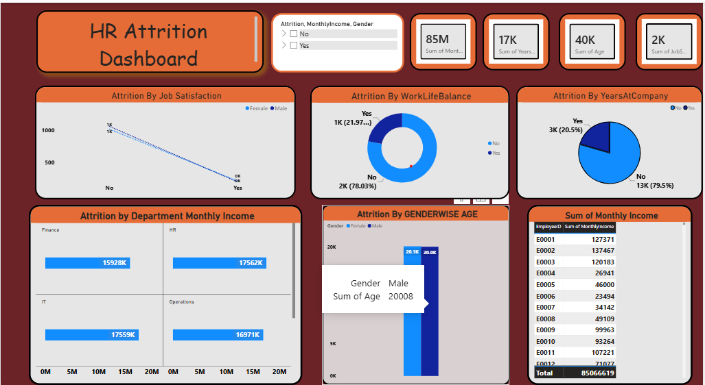

# HR Attrition Dashboard

## Dashboard Preview

## Project Overview

This project features an interactive **HR Attrition Dashboard built
using Microsoft Power BI**. It explores employee attrition and workforce
metrics across departments, gender, job satisfaction, work-life balance,
and years at the company. The dashboard is designed to help HR teams
monitor workforce patterns and identify areas that may need attention.

## Key Metrics

The dashboard highlights summary indicators including: - Monthly
income - Years at company - Employee age - Job-related metrics

## Dashboard Features

-   **Attrition by Job Satisfaction:** Compares attrition patterns by
    job satisfaction and gender.
-   **Attrition by Work-Life Balance:** Shows the distribution of
    attrition across work-life balance categories.
-   **Attrition by Years at Company:** Displays attrition patterns based
    on employee tenure.
-   **Department-wise Monthly Income:** Compares monthly income across
    Finance, HR, IT, and Operations.
-   **Gender-wise Age Analysis:** Compares employee age metrics by
    gender.
-   **Employee Income Details:** Provides an employee-level view of
    monthly income.
-   **Interactive Filters:** Includes slicers such as attrition, monthly
    income, and gender to explore the data.

## Tools & Technologies

-   Microsoft Power BI
-   Data Analysis
-   Data Visualization
-   Interactive Filters and Slicers
-   Charts, KPI Cards, and Tables

## Project Objective

To analyze HR data, understand employee attrition patterns, compare
workforce metrics across departments and employee groups, and present
insights through an interactive dashboard that supports informed HR
decision-making.

## How to Use

1.  Download or clone this repository.
2.  Open the Power BI report file (`.pbix`) in Power BI Desktop, if
    included.
3.  Use the available filters and visuals to explore the HR data.

## Author

Created as a portfolio project demonstrating HR analytics, data
visualization, and dashboard development using Power BI.
